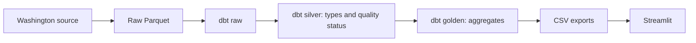

# ⚡ Washington EV Explorer

Explore Washington electric vehicle records by model year, manufacturer, and county.

**Python → Parquet → dbt + DuckDB → CSV → Streamlit**

[](https://github.com/thiagobellotto/electric-vehicles-dbt/actions/workflows/main.yml)

## Run

Install Docker with Docker Compose, then run:

```bash
docker compose up --build
```

Open [localhost:8501](http://localhost:8501). The pipeline runs first; the dashboard starts after it completes.

Python 3.12, uv, dbt, DuckDB, and Streamlit run inside the containers. The first run downloads the Washington dataset into `data/electric_vehicles.parquet`. Later runs reuse that file.

Stop the containers:

```bash
docker compose down
```

## Refresh the data

Download a fresh copy and rebuild the outputs:

```bash
docker compose run --rm pipeline uv run --locked python scripts/build.py --refresh
```

Reload the dashboard to see the new data.

## Pipeline



`pipeline` downloads or reuses the local source, runs dbt, and exports the results. `dashboard` reads the outputs from the shared `artifacts/` directory.

Both folders are beside the Dockerfile and mounted into the containers:

- `data/`: cached source Parquet.
- `artifacts/`: DuckDB databases, CSV exports, and build metadata.

Downloaded data and generated outputs are excluded from Git and Docker image builds.

Each build writes to a separate run directory. After model execution and export succeed, `artifacts/current` points to the new run. Outputs remain on the host after containers stop; older runs can be removed manually.

On pushes to `main` that change `Dockerfile` or `compose.yaml`, CI builds the images, runs the pipeline, waits for the dashboard health check, and uploads the outputs and dbt run artifacts.

## Metrics and data quality

The dashboard defaults to Washington addresses. Choose All source records to include out-of-state addresses. The Overview, Geography, and Data & quality views share the same filters; source-quality totals describe the full dataset.

Charts count source records within a snapshot. Model year describes the vehicle; it does not measure registrations or purchases during that year. County totals are not adjusted for population.

| Field | Handling |
| --- | --- |
| Model year | Exclude missing or invalid values, or years outside 1900 through next year |
| Manufacturer | Exclude missing values |
| County | Group missing values as Unknown |
| Location | Keep the record in counts; omit unusable coordinates from the map |
| Electric range | Treat zero, negative, or missing values as unknown / not reported |

Excluded rows remain in the quality summary. Invalid model year takes precedence over missing manufacturer. The source projection does not retain a vehicle identifier. Map coordinates are source reference points.

## Dependencies

`pyproject.toml` declares runtime dependencies; `uv.lock` records exact versions. uv installs them when the Docker image builds.

Refresh the lockfile through Docker:

```bash
docker compose run --rm --no-deps -v "$PWD:/workspace" -w /workspace pipeline uv lock --upgrade
```

Commit dependency changes and rebuild with `docker compose up --build`.

Source: [Washington Electric Vehicle Population Data](https://catalog.data.gov/dataset/electric-vehicle-population-data).

Developed by [Thiago Bellotto](https://www.linkedin.com/in/thiago-bellotto/).
