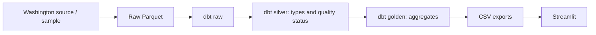

# ⚡ Washington EV Explorer

Explore Washington electric vehicle records by model year, manufacturer, and county.

**Python → Parquet → dbt + DuckDB → CSV → Streamlit**

[](https://github.com/thiagobellotto/electric-vehicles-dbt/actions/workflows/main.yml)

## Run locally

Install [uv](https://docs.astral.sh/uv/getting-started/installation/), then run:

```bash
uv sync --locked
uv run --locked python scripts/build.py
uv run --locked streamlit run streamlit_app.py
```

The default build uses 12 synthetic records: 10 accepted and 2 excluded. To download and process the Washington dataset:

```bash
uv run --locked python scripts/build.py --live
```

Python 3.12 and runtime dependencies are declared in `pyproject.toml`. Exact dependency versions are recorded in `uv.lock`.

## Docker

Docker is an alternative to the local uv setup. CI runs uv directly.

`Dockerfile-dbt` runs the pipeline and exports the results to `artifacts/`:

```bash
mkdir -p artifacts
docker build -f Dockerfile-dbt -t ev-explorer .
docker run --rm -v "$PWD/artifacts:/app/artifacts" ev-explorer
```

Run the dashboard in the same image:

```bash
docker run --rm -p 8501:8501 -v "$PWD/artifacts:/app/artifacts" ev-explorer \
  uv run --locked streamlit run streamlit_app.py --server.address 0.0.0.0
```

Open [localhost:8501](http://localhost:8501). `Dockerfile-s3` provides a separate image for downloading source data and uploading raw Parquet to S3.

## Pipeline



Each build writes to a separate run directory. After model execution and export succeed, `artifacts/current` points to the new run. Previous runs remain available until removed manually.

CI builds the sample and uploads the outputs, dbt manifest, and run results.

## Metrics and data quality

Charts count source records within a snapshot. Model year describes the vehicle; it does not measure registrations or purchases during that year. County totals are not adjusted for population.

| Field | Handling |
| --- | --- |
| Model year | Exclude missing or invalid values, or years outside 1900 through next year |
| Manufacturer | Exclude missing values |
| County | Group missing values as Unknown |
| Location | Keep the record in counts; omit unusable coordinates from the map |
| Electric range | Treat zero, negative, or missing values as unknown / not reported |

Excluded rows remain in the quality summary. Invalid model year takes precedence over missing manufacturer. The source projection does not retain a vehicle identifier. Map coordinates are source reference points.

## S3

Upload a raw snapshot using the standard AWS credential chain:

```bash
uv run --locked python download_data.py --bucket YOUR_BUCKET
```

To run dbt against that object, configure AWS credentials and run from `dbt/`:

```bash
cd dbt
EV_INPUT_PATH=s3://YOUR_BUCKET/electric_vehicles.parquet \
  uv run --locked dbt run --profiles-dir . --target s3
```

The dashboard reads local exports from `artifacts/current`.

## Update dependencies

```bash
uv add PACKAGE
uv lock --upgrade
uv sync --locked
```

Commit `pyproject.toml` and `uv.lock` together.

Source: [Washington Electric Vehicle Population Data](https://catalog.data.gov/dataset/electric-vehicle-population-data).

Developed by [Thiago Bellotto](https://www.linkedin.com/in/thiago-bellotto/).
