# ⚡ Washington EV Explorer

A reproducible analytics pipeline that turns vehicle records into an explorable snapshot, with explicit quality rules and staged publication.

**Python → Parquet → dbt + DuckDB → CSV artifacts → Streamlit**

[](https://github.com/thiagobellotto/electric-vehicles-dbt/actions/workflows/main.yml)

## Try it locally

Requires [uv](https://docs.astral.sh/uv/getting-started/installation/). Python 3.12 is declared in `pyproject.toml`; uv can install it automatically. No AWS account or credentials are needed for the demo.

```bash
uv sync --locked
uv run --locked python scripts/build.py
uv run --locked streamlit run streamlit_app.py
```

The checked-in sample contains **12 synthetic records**: 10 accepted and 2 excluded. It demonstrates missing coordinates, invalid model years, missing manufacturer names, and unknown ranges. It provides no evidence about actual Washington EV market shares.

To analyze the current public source instead:

```bash
uv run --locked python scripts/build.py --live
```

This downloads the full Washington dataset; internet access and a longer build are required. The dashboard labels the dataset and build time. Build time is not the source's observation date.

## Dependency management

`pyproject.toml` declares runtime dependencies and Python 3.12. `uv.lock` pins the resolved versions. Local setup, CI, and Docker use `uv sync --locked`; commands use `uv run --locked`, so stale project metadata fails rather than silently changing the lockfile. No virtual-environment activation is needed.

```bash
uv add PACKAGE                 # Add a runtime dependency and update the lock
uv lock --upgrade              # Refresh locked versions within declared bounds
uv sync --locked
uv run --locked python scripts/build.py
```

Commit `pyproject.toml` and `uv.lock` together after dependency changes. CI and Docker pin uv 0.13.5.

## Questions this project answers

- Which model years and manufacturers are represented in a source snapshot?
- How are vehicle records distributed across counties?
- How many records were excluded, and why?

**Model year is not registration year.** The charts describe snapshot composition, not annual purchases, historical adoption, or population-adjusted adoption rates. No live market findings are claimed until a real source run is reviewed.

## Architecture

```mermaid
flowchart LR
    A[WA public source / synthetic fixture] --> B[Schema validation]
    B --> C[Raw Parquet snapshot]
    C --> D[dbt raw: preserve records]
    D --> E[dbt silver: types and quality status]
    E --> F[dbt golden: analytical aggregates]
    F --> G[Export CSV artifacts]
    G --> H[Immutable local run + atomic current pointer]
    H --> I[Streamlit explorer]
```



The pipeline stages every run in a temporary directory. Only a successful `dbt run` and complete export can update `artifacts/current`. The dashboard resolves that pointer once per rerun, so it reads one consistent version. Prior runs are retained locally; storage cleanup is manual.

## Data quality rules

| Rule | Behavior |
| --- | --- |
| Unexpected source schema | Fail with the missing column names |
| Missing/invalid model year, outside 1900 through next year | Retain source row; exclude from analytical totals with reason |
| Missing manufacturer | Retain source row; exclude with reason |
| Missing county | Include in an Unknown county aggregate |
| Missing coordinates or electric range | Retain vehicle in counts |
| Zero/negative/missing electric range | Label unknown / not reported; do not infer usable range |
| Failed rebuild | Leave the previously published run available |

This projection does not retain a stable vehicle identifier, so uniqueness is not asserted. Coordinates are source reference locations; they are not precise vehicle positions. Multiple exclusion conditions use a documented precedence: invalid model year first, then missing manufacturer.

## Inspect model documentation

```bash
cd dbt
# Uses paths relative to this directory after a successful sample/live build:
EV_INPUT_PATH="../artifacts/$(cat ../artifacts/current)/input.parquet" \
EV_DB_PATH="../artifacts/$(cat ../artifacts/current)/ev.duckdb" uv run --locked dbt docs generate --profiles-dir .
uv run --locked dbt docs serve --profiles-dir .
```

PR CI uses the deterministic sample, runs `dbt run`, and uploads the sample output plus dbt manifest and run results. No AWS secrets are used in PR builds.

## Optional S3 path

Raw snapshot upload remains available using the standard AWS credential chain:

```bash
uv run --locked python download_data.py --bucket YOUR_BUCKET
```

For direct dbt builds against that object, run from `dbt/` with `EV_INPUT_PATH=s3://YOUR_BUCKET/electric_vehicles.parquet`, `--target s3`, and AWS credentials in your environment, using `uv run --locked dbt run --profiles-dir . --target s3`. The local build command is the supported dashboard publishing path. This release replaces the previous push-to-main S3 publishing workflow with credential-free builds; it does **not** deploy or refresh an existing S3-backed dashboard.

## Engineering decisions and next steps

DuckDB keeps this single-source workload reproducible without a warehouse account. dbt supplies model lineage and descriptions. Publication uses a local single-writer workflow; concurrent builds and automatic retention are not supported.

Next milestones: review a full live-source run, publish a demo, and retain dated source snapshots for changes over time.

Original project by [Thiago Bellotto](https://www.linkedin.com/in/thiago-bellotto/). Source: [Washington Electric Vehicle Population Data](https://catalog.data.gov/dataset/electric-vehicle-population-data).
